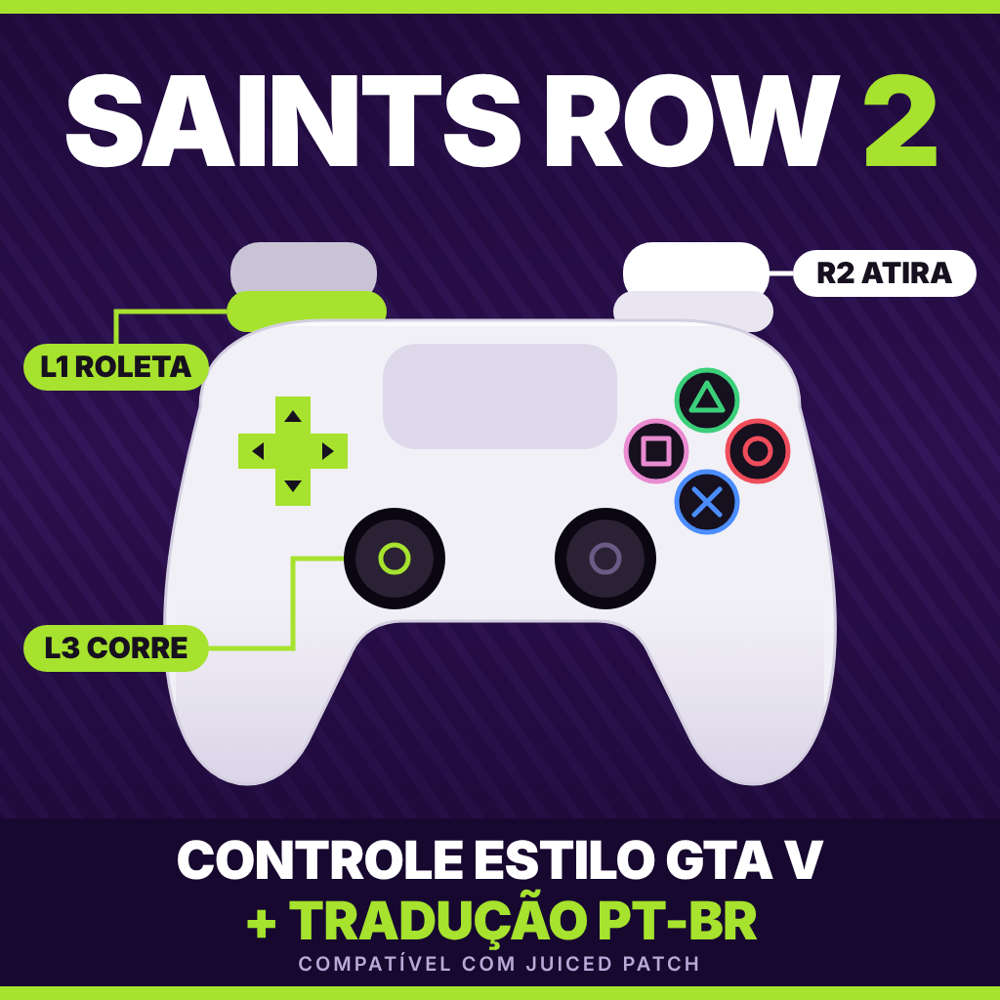

# Saints Row 2 (PC): controle estilo GTA V + tradução PT-BR

Pacote para **Saints Row 2 + Juiced Patch** com:

- **Controle estilo GTA V para DualSense** (RowInput + plugin `StickCombo`)
- **Tradução PT-BR** que funciona com o Juiced (sem substituir arquivos do jogo)
- Opções do `juiced.ini` (mira só segurando L2, pular intros)

Os pacotes são independentes: instale só o controle, só a tradução, ou os dois.

## Requisitos

- Saints Row 2 (Steam ou GOG) com o [Juiced Patch](https://github.com/kobraworksmodding/Saints-Row-2-Juiced-Patch) (testado com a v9.3.1)
- Windows, jogo 32 bits
- DualSense (PS5) lido via SDL3 do Juiced. Outros controles reconhecidos pelo SDL devem funcionar, mas não foram testados.

Baixe o pacote pronto em **[Releases](../../releases)** ou copie as pastas deste repositório.

## 1) Controle

**Instalar:** feche o jogo, copie `controle/dinput8.dll` e `controle/scripts/` para a pasta do jogo (onde fica o `SR2_pc.exe`), mesclando com `scripts` se já existir. No `juiced.ini` use `SDL=1` e `HoldFineAim=1` (veja [`opcoes/`](opcoes/OPCOES-juiced.ini.txt)).

> Não altere os controles pelo menu do jogo. Edite `scripts/RowInput/*.ini` (relidos com o jogo pausado).

### Layout (X=Xis, O=Bolinha, □=Quadrado, △=Triângulo)

**A pé**

| Botão | Ação |
|---|---|
| R2 | Atirar |
| L2 (segurar) | Mirar (só enquanto segura) |
| □ | Pular |
| O | Recarregar |
| △ | Entrar no veículo / ação |
| L1 (segurar) | Roda de armas; **R3** escolhe a arma (câmera e personagem ficam parados) |
| L3 parado | Agachar |
| L3 com analógico para frente | Correr |
| D-Pad Esq/Dir | Provocar / elogiar |
| D-Pad Cima/Baixo | Recrutar / cancelar atividade |
| R3 (sem L1) | Coronhada |

**De carro:** R2 acelera, L2 freia/ré, R1 freio de mão, L1 atira, L3 buzina, R3 olhar para trás, X nitro, D-Pad Esq/Dir rádio, D-Pad Baixo piloto automático.

**Avião / helicóptero:** R2 acelera, L2 desacelera, L1/R1 leme, X e □ disparam, R3 olhar para trás.

### Peças

- **RowInput** (Clippy95): troca o esquema de botões por situação. Originais em `scripts/RowInput/_esquemas-originais`.
- **dinput8.dll**: Ultimate ASI Loader (ThirteenAG, MIT), carrega os `.asi`.
- **StickCombo.asi**: agachar/correr no L3 e roda de armas no R3. Código em [`codigo-fonte/`](codigo-fonte/StickCombo.c). Troca o ponteiro de `SDL_GetGamepadAxis` no `DFEngine.dll` e só age se o endereço bater com o esperado.

### Personalizar

Botões: `A B X Y LB RB SELECT START LS RS LT RT DPadUp DPadDown DPadLeft DPadRight` (padrão Xbox). Ações e lista completa: [Clippy95/RowInput](https://github.com/Clippy95/RowInput).

## 2) Tradução PT-BR

1. Feche o jogo.
2. Copie `traducao-ptbr/Mods/PT-BR Translation` para a pasta `Mods` do jogo.
3. Adicione ao final do `loose.txt` da pasta do jogo: `mods/PT-BR Translation`
4. Deixe `ForceLanguage=NA` no `juiced.ini`.

> **Não use o instalador original (.exe) da tradução com o Juiced.** Ele troca o `patch.vpp_pc` por uma versão de 2015 e o jogo trava ao carregar.

A tradução é de 2015 e sem acentos; textos novos do Juiced/TU3 podem aparecer em inglês. Para desinstalar, apague a linha do `loose.txt` e a pasta do mod.

## Problemas comuns

- **Trava ao abrir:** remova `scripts/StickCombo.asi` e/ou a linha da tradução no `loose.txt` para achar o culpado.
- **Controle não responde:** confira `SDL=1` (teste `SDL=0` só como último recurso).
- **Steam Input ativo** pode remapear o controle antes do SDL; desative para o SR2.
- **Ícones de botão** na tela não mudam com o RowInput.

Desinstalar o controle: apague `dinput8.dll` e a pasta `scripts`. Faça backup do `juiced.ini` antes de editar.

## Créditos

- **Juiced Patch:** Kobraworks e colaboradores
- **RowInput:** Clippy95; esquema SRTT por ItsIggy
- **Ultimate ASI Loader:** ThirteenAG (MIT) — [licença](licencas/LICENSE-Ultimate-ASI-Loader.txt)
- **Tradução PT-BR:** [Central de Traduções](https://www.centraldetraducoes.net.br/2015/03/traducao-do-saints-row-2-pc.html) — ver [CREDITOS.md](traducao-ptbr/CREDITOS.md)
- **StickCombo.asi, ajustes de layout e empacotamento:** Igor

Feito por fã, sem fins comerciais. Use por sua conta e risco e faça backup. Os textos e o jogo pertencem à Volition / Deep Silver.
